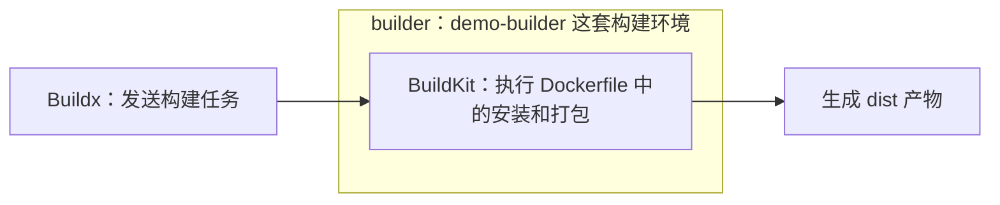
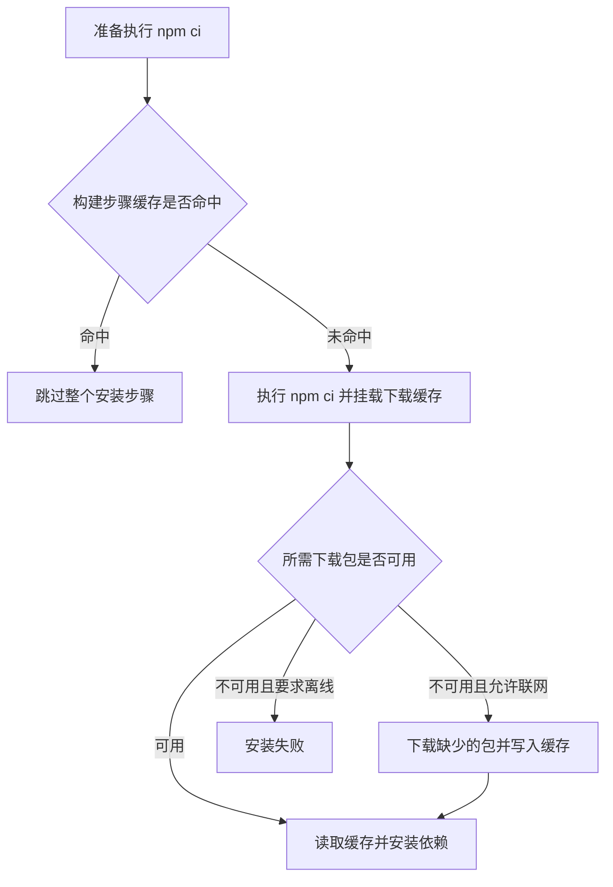
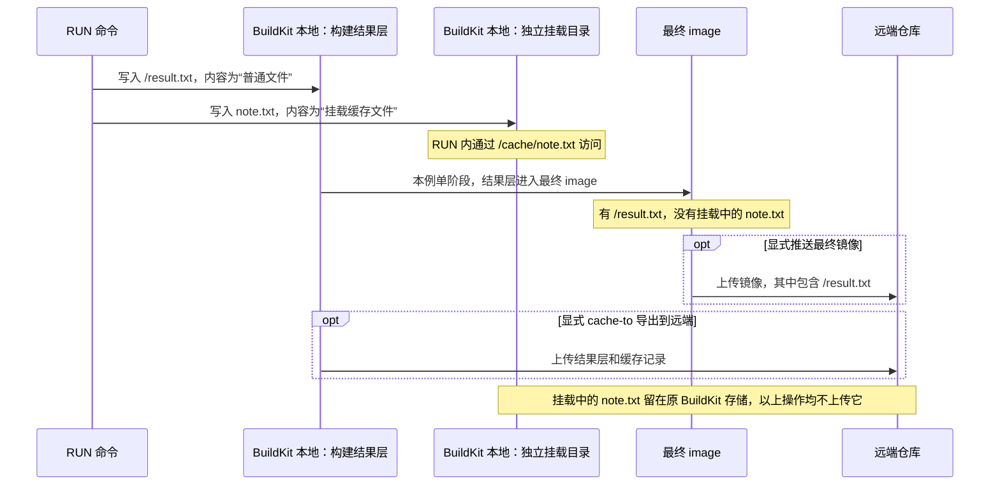
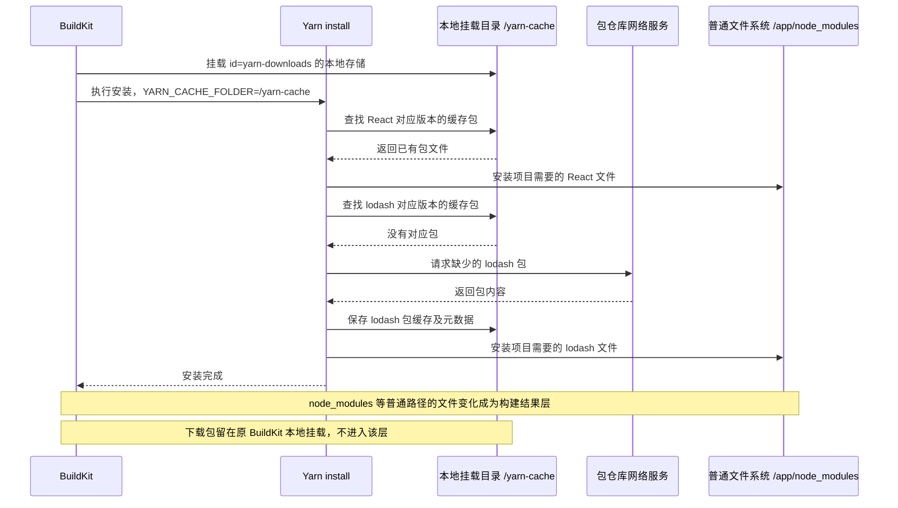

# Docker Buildx 和 BuildKit 前端构建与缓存实战教程

用一个 npm 前端项目，走通 Docker 构建、产物导出和缓存验证。读完后，你应该能分清：谁执行构建、结果保存在哪里、为什么构建成功却找不到镜像，以及怎样确认 npm 没有重复下载包。

本例项目是 Vite、React、TypeScript，使用 Node 24。项目目录为 `/Users/yhding/ws/demo/buildkit`，构建器名为 `demo-builder`。本次缓存验证使用 BuildKit 0.33.1 和 `docker-container` 驱动。

先记住三件事：

- `CACHED RUN npm ci` 表示整个安装步骤跳过了。
- `RUN --mount=type=cache` 在当前 BuildKit 的本地存储中保留下载包；后续安装必须能访问同一份存储，才能复用，不会自动上传远端。
- 验证下载缓存时，不要用本例中的 `--no-cache`；它会重置安装步骤使用的缓存挂载。可靠方法是让安装步骤重跑，再验证断网安装能否成功。

### 阅读前先固定四个对象与保存位置

本文不再用单独的“缓存”二字同时指代以下不同对象：

| 对象 | 实际是什么 | 默认存在哪里 | 普通 cache-to 是否上传 |
| --- | --- | --- | --- |
| BuildKit 程序 | 执行 Dockerfile 的构建引擎 | 执行构建的机器或容器 | 否，不把程序装进应用镜像 |
| 构建结果层 | 真实文件变化，例如安装好的 `/app/node_modules` | 当前 BuildKit 存储 | 导出范围包含该结果时上传 |
| 缓存记录 | 输入、构建操作与结果层的对应关系 | 当前 BuildKit 存储 | 与结果层一起导出，供其他 builder 匹配 |
| 本地缓存挂载 | RUN 的 cache mount 中的文件，例如 `/yarn-cache` 下载包 | 当前 BuildKit 的独立本地存储 | 否；inline、registry max、local 都不会自动同步它 |

先固定“机器 A 上传、机器 B 使用”的场景：

```text
A 执行 yarn install
├─ /app/node_modules → 真实构建结果层
│   └─ cache-to 成功 → 上传结果层＋缓存记录到远端
└─ /yarn-cache → 本地缓存挂载
    └─ 留在 A 的 BuildKit 磁盘存储，不随上述导出上传

B 使用 cache-from
├─ A 已上传结果层＋记录，且输入匹配 → 使用真实 node_modules，跳过安装
├─ A 已上传，但 lock 改变 → 旧安装结果仍在远端，只是不匹配本次步骤
│   └─ 从安装步骤之前的文件系统重新执行；B 没有恢复下载目录就需要下载包
└─ A 从未导出层缓存，也没推送带 inline 元数据的镜像 → 没有这份远端缓存可读
```

“没有上传”的对象是本地 cache mount 目录；“从远端读取”的对象是此前成功上传的结果层和缓存记录。两句话不能省略对象。仅写 cache-from 不会自动上传；仅构建、不导出，也不会让新机器凭空找到结果。

普通 build 已经保存了步骤结果，cache-to 不是让 RUN 才开始产生层。普通镜像 push 交付最终镜像所需的层；多阶段中被最终阶段丢下的 Node 安装结果不会因此一起上传。`cache-to ... mode=max` 可以另外导出这些中间结果层与匹配记录。

inline 则把缓存记录嵌入最终镜像配置，相关真实文件仍在镜像层中；必须随后成功推送镜像，远端才有数据。两种方案均不自动包含 cache mount 文件。

你的 `demo-builder` 以 docker-container 驱动运行，磁盘存储在 Docker volume `buildx_buildkit_demo-builder0_state`，挂载到 BuildKit 容器的 `/var/lib/buildkit`；在 Mac 上位于 Docker Desktop 的 Linux 虚拟机内。`/yarn-cache` 只是 RUN 容器看到的挂载入口，不是 Mac 项目目录，也不是远端地址。内部快照路径不一定叫 yarn-cache。

## 1 Buildx 和 BuildKit 以及 builder 的关系

先看本项目已经执行过的命令：

```bash
# 用 demo-builder 这套构建环境，执行指定 Dockerfile。
docker buildx build --builder demo-builder -f Dockerfile.build .
```

这条命令里，三个名字分别对应下面的东西：

| 名称 | 在你的项目里指什么 |
| --- | --- |
| Buildx | 你使用的 `docker buildx` 命令工具，负责发送构建任务 |
| BuildKit | `buildx_buildkit_demo-builder0` 容器里真正执行 Dockerfile 的程序 |
| builder | 你选用的那套构建环境；本例名字叫 `demo-builder` |

**Buildx 发送任务，BuildKit 执行任务，builder 让你选择使用哪套构建环境。**



比如 Dockerfile 写了 `RUN npm ci` 和 `RUN npm run build`，真正启动这些命令、保存缓存、生成静态文件的是 BuildKit。

之前执行 `docker buildx create --name demo-builder --driver docker-container`，是在登记一套名为 `demo-builder` 的构建环境。它第一次启动时，会通过 `moby/buildkit:buildx-stable-1` 镜像创建容器，在里面运行 BuildKit。之后你加上 `--builder demo-builder`，就是选用这一套环境。

如果以后再创建 `other-builder`，就可以通过 `--builder other-builder` 选择另一套环境。它可以在本地，也可以连接到远程；本例只需要理解当前这一套容器环境。[Docker 构建概览](https://docs.docker.com/build/concepts/overview/)、[构建器说明](https://docs.docker.com/build/builders/)

### docker build 与 docker buildx build

现代 Docker 中，`docker build` 通常也是通过 Buildx 调用 BuildKit。两条命令的一个重要区别是默认选择哪个构建器。

| 命令 | 没有显式指定构建器时 |
| --- | --- |
| `docker build` | 默认使用 Docker Engine 自带的构建器 |
| `docker buildx build` | 使用当前选中的构建器 |

两者都可以用 `--builder` 指定构建器。需要独立构建环境、多架构或远程构建时，显式使用 `docker buildx build` 更容易看清配置。[构建器选择规则](https://docs.docker.com/build/builders/#difference-between-docker-build-and-docker-buildx-build)

## 2 准备项目和构建器

本项目已经初始化完成，可以直接检查版本并使用现有文件。

```bash
# 进入本例项目目录。
cd /Users/yhding/ws/demo/buildkit

# 查看 Node 和 Docker Buildx 版本。
node --version
docker buildx version

# 查看已有构建器；星号表示当前选中的构建器。
docker buildx ls
```

如果从一个新的空目录开始，可以用以下命令初始化同款前端项目：

```bash
# 在空目录中初始化 Vite、React、TypeScript 项目。
npm create vite@latest . -- --template react-ts --no-interactive

# 安装依赖，生成 package-lock.json。
npm install

# 检查类型并打包；生成的静态文件位于 dist。
npm run build
```

这些初始化命令使用 Node 24。[Vite 初始化说明](https://vite.dev/guide/#scaffolding-your-first-vite-project)

如果列表里还没有 `demo-builder`，创建它：

```bash
# 创建并选中独立的 BuildKit 构建器；已有同名构建器时跳过创建。
docker buildx create --name demo-builder --driver docker-container --use

# 启动构建器并查看 BuildKit 版本及支持的平台。
docker buildx inspect --bootstrap demo-builder
```

第一次启动会拉取 `moby/buildkit:buildx-stable-1`，并创建类似 `buildx_buildkit_demo-builder0` 的容器。这是执行构建所需的工具镜像，和应用的 Node 基础镜像、最终应用镜像各有不同用途。[docker-container 驱动](https://docs.docker.com/build/builders/drivers/docker-container/)

## 3 编写用于生成静态文件的 Dockerfile

本项目有两个文件：

| 文件 | 用途 |
| --- | --- |
| `Dockerfile.build` | 执行前端打包，供 Buildx 导出静态文件 |
| `Dockerfile` | 打包后将静态文件放进 Nginx，生成可运行的页面镜像 |

`Dockerfile.build` 内容如下：

```dockerfile
# syntax=docker/dockerfile:1

# 构建阶段：使用 Node 24 安装依赖并生成前端产物。
FROM node:24-bookworm-slim AS build
WORKDIR /app

# 先复制依赖清单，业务代码变化时仍可复用安装步骤。
COPY package.json package-lock.json ./

# 缓存 npm 下载包；http 日志用于观察缓存读取和网络下载。
RUN --mount=type=cache,target=/root/.npm \
    npm ci --prefer-offline --no-audit --no-fund --loglevel=http

# 复制源码，执行 TypeScript 检查和 Vite 生产构建。
COPY . .
RUN npm run build

# 产物阶段：只保留 dist 中的静态文件，供本地导出。
FROM scratch AS artifact
COPY --from=build /app/dist /
```

最后的 `scratch` 阶段相当于一个空文件系统，把 `/app/dist` 内容放到它的根目录。导出时就只拿到页面文件，而不会把 Node、源码和 `node_modules` 一起导出。

同时设置 `.dockerignore`，避免把本地依赖和已有构建产物带进构建上下文：

```text
node_modules
dist
dist-docker
.git
.DS_Store
*.log
.env
.env.*
!.env.example
```

`dist-docker` 必须排除，否则前一次导出的文件可能被下一次 `COPY . .` 再次复制进去，干扰缓存判断。

### 安装命令中的参数

| 参数或路径 | 用途 |
| --- | --- |
| `npm ci` | 根据已有锁文件安装依赖，适合构建环境 |
| `--prefer-offline` | 优先使用已有缓存；缺少内容时仍可联网获取 |
| `--no-audit` | 安装时不执行安全审计请求 |
| `--no-fund` | 不输出依赖的资助提示 |
| `--loglevel=http` | 显示缓存和 HTTP 请求日志，验证完可去掉 |
| `/root/.npm` | root 用户的 npm 下载缓存目录 |
| `/app/node_modules` | 当前构建环境中安装好的项目依赖 |

挂载的是下载缓存，不是 `node_modules`。每次真正执行 `npm ci` 时，仍需把依赖安装进当前文件系统；复用下载包省掉的是重复下载。[npm ci](https://docs.npmjs.com/cli/v11/commands/npm-ci/)、[npm 日志](https://docs.npmjs.com/cli/v11/using-npm/logging/)

## 4 第一次构建并导出产物

```bash
# 在项目目录中构建，将 artifact 阶段的文件导出到 dist-docker。
docker buildx build --builder demo-builder \
  -f Dockerfile.build \
  --progress=plain \
  --output type=local,dest=./dist-docker .
```

| 命令部分 | 含义 |
| --- | --- |
| `--builder demo-builder` | 使用指定的构建器 |
| `-f Dockerfile.build` | 使用这个 Dockerfile，而非默认文件名 |
| `--progress=plain` | 显示完整文本日志，方便观察每个步骤 |
| `--output type=local,dest=./dist-docker` | 将最终阶段的文件导出到本地目录 |
| 末尾的 `.` | 当前目录是构建上下文，`COPY` 的源文件来自这里 |

首次构建通常需要解析 Dockerfile 语法、下载 Node 基础镜像、执行 `npm ci` 和打包，再导出文件。日志中的不同镜像分别是：

- `moby/buildkit:buildx-stable-1`：构建引擎运行环境。
- `docker/dockerfile:1`：解析 Dockerfile 的组件，来自第一行 `# syntax=...`。
- `node:24-bookworm-slim`：执行本项目安装和打包的基础环境。

构建完成后，`dist-docker/` 中应有 `index.html`、`assets/` 和项目的其他公开静态文件。

本命令选择的是文件输出，所以查看结果应打开 `dist-docker/`。镜像输出方式见第 10 节。

## 5 再构建一次并阅读缓存日志

源码和依赖不变，再执行第 4 节的命令。

本次实测的主要步骤如下：

```text
CACHED [build 2/6] WORKDIR /app
CACHED [build 3/6] COPY package.json package-lock.json ./
CACHED [build 4/6] RUN ... npm ci ...
CACHED [build 5/6] COPY . .
CACHED [build 6/6] RUN npm run build
CACHED [artifact 1/1] COPY --from=build /app/dist /
exporting to client directory
copying files 236.13kB
```

`CACHED RUN npm ci` 表示安装命令根本没有重新执行。`CACHED RUN npm run build` 也表示直接复用上次的打包结果，没有再执行 TypeScript 检查或 Vite。

这里复用的是先前保存的安装结果和打包文件。`npm ci`、TypeScript 检查和 Vite 都没有重新执行，也不会重放上次的终端输出。

### 命中缓存后仍有耗时

| 日志 | 为什么仍需要处理 |
| --- | --- |
| `load build definition` | 读取本次使用的 Dockerfile |
| `resolve image config ... docker/dockerfile:1` | 解析 Dockerfile 解析器镜像的信息 |
| `load metadata ... node:24-bookworm-slim` | 处理基础镜像元数据；不等于重新下载镜像层 |
| `load build context` | 检查和传输需要的项目文件 |
| `exporting to client directory` | 将结果交付到本地输出目录 |

构建上下文支持增量传输。日志中出现 `transferring context: 889B` 或 `1.60kB` 是本次传输量，不是整个项目大小。不同步骤也可能并行，耗时不能简单相加。[BuildKit 的增量传输和并行构建](https://docs.docker.com/build/buildkit/)

## 6 构建步骤缓存和下载缓存各自解决什么问题

两层缓存的区别在于：一层决定安装要不要执行，另一层决定执行时的包从哪里来。



下表中复用下载包的前提：后续构建仍访问原来的 BuildKit 本地存储、使用相同缓存 id，且包未被清理。全新 builder 从远端导入层缓存，不会恢复该下载目录。

| 场景 | 安装步骤 | BuildKit 本地下载目录的作用 |
| --- | --- | --- |
| 什么都不改 | 通常直接 `CACHED` | 安装跳过，未实际读取下载缓存 |
| 只修改业务源码 | 因为先复制依赖清单，安装通常仍 `CACHED` | 安装跳过；源码复制和打包重跑 |
| 修改依赖清单或锁文件，且无匹配的新步骤结果 | 重新执行 | 原 BuildKit 本地挂载仍在时复用已有包；否则需要重新下载 |
| 修改安装命令或其使用的参数，且没有匹配的旧步骤缓存 | 重新执行 | 仍访问原 BuildKit 存储、使用相同 id 且数据未清理时，可读取本地挂载 |
| 换一个独立 builder | 使用另一套缓存存储 | 通常需要重新填充 |
| 使用本例的 `--no-cache` | 重新执行 | 当前实现会重置相关缓存挂载 |

例如项目已经安装 React，之后新增 lodash：如果没有匹配新依赖清单的安装结果，安装步骤需要重跑。只有仍访问原来的 BuildKit 本地存储、相同挂载 id 且下载包未被清理，才可读取原来的 React 下载包并补下载缺少内容。换成使用全新存储的 builder，仅导入远端层缓存，不能恢复这些下载包。日常构建保留 `--mount=type=cache` 仍然有价值。[缓存挂载的用途](https://docs.docker.com/build/cache/optimize/#use-cache-mounts)

## 7 为什么不使用 no cache 验证下载缓存

下面这个命令可以强制重跑构建步骤，但不适合验证本例的下载缓存复用：

```bash
# 用于要求重新构建；会影响相关缓存挂载，不用于验证下载缓存复用。
docker buildx build --builder demo-builder \
  -f Dockerfile.build \
  --no-cache \
  --progress=plain \
  --output type=local,dest=./dist-docker .
```

在本次 BuildKit 0.33.1 和默认缓存挂载配置下，忽略缓存的执行步骤所使用的缓存挂载会在构建前被重置。因此 `/root/.npm` 中之前用于这一步的下载缓存没有被复用，安装又去下载了包。这不等于 `--no-cache` 清空了 builder 的全部缓存；基础镜像和解析器等仍可以复用。

这一行为可在 [BuildKit 的缓存挂载识别代码](https://github.com/moby/buildkit/blob/v0.33.1/solver/llbsolver/vertex.go) 和 [构建前清理代码](https://github.com/moby/buildkit/blob/v0.33.1/solver/llbsolver/bridge.go) 中确认，维护者也在 [相关问题讨论](https://github.com/moby/buildkit/issues/5305) 中说明过。缓存挂载参数和实现版本可能影响细节，教程中的验证流程不依赖这个选项。

`WORKDIR /app` 在本次 `--no-cache` 日志里仍显示 `CACHED`。它对应目录状态操作，当前实现没有像 `RUN` 那样设置忽略缓存标记。这不影响 `npm ci` 和 `npm run build` 真正执行。[Dockerfile 转换实现](https://github.com/moby/buildkit/blob/master/frontend/dockerfile/dockerfile2llb/convert.go)

## 8 用联网填充和断网安装验证下载缓存

目标是让第二次安装真正执行，并读取第一次保存在同一份 BuildKit 本地存储中的下载包；本实验没有上传或下载远端缓存。这里用独立的测试 Dockerfile，不需要改生产构建文件。

### 创建测试文件

在项目目录执行：

```bash
# 创建只安装依赖的缓存测试文件。
cat > Dockerfile.cache-check <<'EOF'
# syntax=docker/dockerfile:1
FROM node:24-bookworm-slim
WORKDIR /app
COPY package.json package-lock.json ./

# npm 安装模式：优先离线或完全离线，由构建参数选择。
ARG NPM_MODE=prefer-offline
# 验证编号：每轮更换，让安装步骤重新执行。
ARG CACHE_PROBE=0

# 仅在同一份 BuildKit 本地存储内复用此挂载；不会上传远端。
# 输出编号，确认本次步骤真正执行。
RUN --mount=type=cache,target=/root/.npm \
    echo "缓存验证编号：${CACHE_PROBE}" \
    && npm ci --${NPM_MODE} --no-audit --no-fund --loglevel=http
EOF
```

这个测试文件只复制依赖清单，不执行前端打包。`NPM_MODE` 和 `CACHE_PROBE` 都在安装步骤中使用。使用没有匹配旧步骤缓存的新参数值，才能让安装步骤重新执行；已经使用过的参数组合仍可能显示 `CACHED`。

### 第一次允许联网并填充缓存

```bash
# 第一轮安装允许获取缺少的下载包，结果只保留在构建缓存中。
docker buildx build --builder demo-builder \
  -f Dockerfile.cache-check \
  --build-arg NPM_MODE=prefer-offline \
  --build-arg CACHE_PROBE=1 \
  --progress=plain \
  --output=type=cacheonly .
```

### 第二次更换参数并禁用安装步骤的网络

```bash
# 改变参数强制重装；完全离线模式和禁用网络共同验证下载包复用。
docker buildx build --builder demo-builder \
  -f Dockerfile.cache-check \
  --build-arg NPM_MODE=offline \
  --build-arg CACHE_PROBE=2 \
  --network=none \
  --progress=plain \
  --output=type=cacheonly .
```

两个命令都不加 `--no-cache`。每次重新做实验，要使用新的验证编号，例如将第一轮和第二轮改成 `3`、`4`，避免复用上一轮安装步骤的结果。

成功的判断条件是：

1. 安装步骤没有显示 `CACHED`，并输出本轮验证编号。
2. `npm ci --offline` 真正执行并成功退出。
3. 安装步骤的网络已禁用，没有依赖包的网络下载。

这三个条件一起成立，才能说明已有下载缓存足以安装当前依赖。`--network=none` 限制的是 Dockerfile 中的执行步骤；Dockerfile 解析器和基础镜像的元数据解析仍可能联网，不能据此声称整个构建过程完全断网。

本次实际验证采用同一个 `/root/.npm` 缓存挂载，安装步骤禁网并执行 `npm ci --offline`，结果为：

```text
added 30 packages in 652ms
DONE 0.9s
```

30 个包在约 0.65 秒内安装完成，整个安装步骤约 0.9 秒，没有包下载请求。这直接说明 npm 下载缓存能正常复用。具体耗时随机器、依赖和缓存状态变化。

如果出现 `ENOTCACHED` 或缺少离线内容，应先用新的编号执行联网填充，再更换编号断网验证。仅重新执行一个已经显示 `CACHED` 的联网安装步骤，不会再次填充已被清理的下载缓存。

## 9 正确解读 npm 的 hit 和 miss 日志

这次 HTTP 日志中的 React 包先后出现以下记录，地址为节选：

```text
npm http cache react@https://registry.npmmirror.com/...react-19.3.0.tgz 0ms (cache hit)
npm http fetch GET 200 https://cdn.npmmirror.com/...react-19.3.0.tgz 328ms (cache miss)
```

不能看到第一行就判定下载缓存成功。npm 使用的 pacote 下载库会在创建缓存读取流时打印 `cache hit`；随后读取失败，仍可以回退到网络。此时后面的实际下载记录更能说明结果。[pacote 缓存读取与回退实现](https://github.com/npm/pacote/blob/main/lib/fetcher.js)

这份日志中，30 个包都有初始 `cache hit` 提示，随后又都有 CDN 下载及 `cache miss`。这一次实际重新下载了包，安装步骤总共约 10.2 秒。

| 日志 | 可以得出的结论 |
| --- | --- |
| `CACHED RUN ... npm ci ...` | 整个安装步骤跳过，没有验证下载缓存 |
| 单独的 `npm http cache ... (cache hit)` | 有缓存读取提示，需要结合后续记录判断 |
| 同一个包随后出现 `fetch GET 200 ...tgz ... (cache miss)` | 实际发生了该包的网络下载 |
| `added 30 packages` | 安装完成，不能单凭这一行判断包来源 |
| 执行步骤禁网，离线安装仍成功 | 已有下载缓存足以安装当前依赖 |

`--prefer-offline` 是优先使用缓存，不是禁止网络；`--offline` 才要求 npm 不从网络获取缺少的内容。即使包下载全部复用，npm 仍需要解压和写入 `node_modules`，因此安装不会完全没有耗时。

## 10 构建缓存和 load 以及 push 的关系

BuildKit 的缓存、当前 Docker Engine 的镜像库、远程镜像仓库分别有不同用途。

| 位置 | 用途 | 如何查看 |
| --- | --- | --- |
| builder 的缓存存储 | 加速后续构建，保存步骤结果和缓存挂载 | `docker buildx du --builder demo-builder` |
| 当前 Docker Engine 镜像库 | 保存本地可运行的镜像 | `docker images` |
| 远程镜像仓库 | 供其他机器拉取镜像 | 仓库页面或镜像管理命令 |
| 本地 `dist-docker/` | 保存导出的静态页面文件 | 文件系统 |

对于默认配置的 `docker-container` builder：

| 输出方式 | 最终结果在哪里 |
| --- | --- |
| 未指定输出 | 结果留在构建缓存中，不自动加载镜像 |
| `--load` | 导出并加载镜像到当前 Docker Engine |
| `--push` | 导出并推送镜像到指定远程仓库 |
| `--output type=local,dest=...` | 将最终阶段文件导出到本地目录 |

`-t` 只是给镜像输出指定名字，不会代替 `--load` 或 `--push`。`docker` 驱动默认会加载镜像；自定义驱动也可能配置自动加载，因此要结合实际驱动看输出行为。[驱动与输出规则](https://docs.docker.com/build/builders/drivers/)

### 生成并运行 Nginx 页面镜像

本项目现有 `Dockerfile` 会执行打包，并将结果放进 Nginx：

```bash
# 使用现有的生产 Dockerfile，并将镜像加载到本地。
docker buildx build --builder demo-builder \
  -f Dockerfile \
  --load --progress=plain \
  -t buildkit-frontend:demo .

# 确认最终镜像已进入当前 Docker Engine。
docker images buildkit-frontend:demo

# 启动页面服务，访问 http://localhost:8080；Ctrl+C 停止服务。
docker run --rm -p 8080:80 buildkit-frontend:demo
```

推送时，将 `yourname` 替换为有权限的 Docker Hub 命名空间：

```bash
# 构建并推送最终页面镜像；先确保已登录并拥有仓库推送权限。
docker buildx build --builder demo-builder \
  -f Dockerfile --push \
  -t yourname/buildkit-frontend:demo .
```

输出镜像和保留构建缓存可以同时发生。`--load`、`--push` 都不表示把缓存搬走，也不会导出 `/root/.npm` 缓存挂载。

## 11 apt 安装也可以使用下载缓存

在 Debian 或 Ubuntu 基础镜像中，可以缓存 apt 下载包和索引。以下是独立示例：

```dockerfile
# syntax=docker/dockerfile:1
FROM ubuntu:24.04

# 关闭镜像自带的下载包自动清理，并配置保留下载包。
RUN rm -f /etc/apt/apt.conf.d/docker-clean \
    && echo 'Binary::apt::APT::Keep-Downloaded-Packages "true";' \
       > /etc/apt/apt.conf.d/keep-cache

# 缓存下载包和索引；加锁避免并发构建同时修改 apt 数据。
RUN --mount=type=cache,target=/var/cache/apt,sharing=locked \
    --mount=type=cache,target=/var/lib/apt,sharing=locked \
    apt-get update \
    && apt-get install -y --no-install-recommends curl
```

apt 需要独占访问相关缓存，因此这里使用 `sharing=locked`。不要在这个缓存安装步骤中再运行 `apt-get clean`，否则会清掉准备复用的下载包。逻辑与 npm 相同：整步命中时跳过安装；步骤需要重跑时，再利用下载缓存。[apt 官方示例](https://docs.docker.com/reference/dockerfile/#example-cache-apt-packages)

## 12 CI 中的缓存边界

缓存挂载只保存在执行任务的 BuildKit 所使用的磁盘存储中，不进入镜像层。如果每次 CI 都创建使用全新存储的 builder，`/root/.npm` 下载缓存也会从空开始。同一台宿主机不代表同一份 BuildKit 存储；仅重启 Runner 程序也不等于删除存储。

`--cache-to` 和 `--cache-from` 用于导出、导入构建缓存，但不会导出或恢复 `type=cache` 挂载目录。不能只配置远程构建缓存，就认为 npm 下载缓存也跨机器保存了。跨任务复用下载缓存需要持久化 builder，或者另行保存和恢复挂载目录。[缓存挂载边界](https://docs.docker.com/reference/dockerfile/#run---mounttypecache)

缓存也可能被垃圾回收或手动清理。构建必须能在缓存为空时重新完成；缓存提供的是加速，不应成为正常联网构建能否成功的前提。

以上规则针对在 Docker 构建中执行 npm 的方式。第 19 节的业务 Job 直接使用预制 Node 工具镜像执行 npm 命令，下载缓存改由 GitLab `cache` 保存项目目录中的 `.npm/`，不使用 BuildKit 缓存挂载。

## 13 常见问题的定位方法

| 现象 | 先看什么 | 处理方式 |
| --- | --- | --- |
| `failed to read dockerfile` | 当前目录、末尾构建上下文、`-f` 路径 | 回到项目目录，并明确指定 `-f Dockerfile.build` |
| 构建成功但 `docker images` 没有结果 | 选择的输出类型，是否完成导入 | 文件输出看 `dist-docker/`；镜像输出用现有 `Dockerfile` 加 `--load` |
| 加了 `--load` 仍无镜像 | 日志最后是否有错误、是否完成 `importing to docker` | 先解决构建错误；构建失败时没有可加载的结果 |
| 镜像似乎加载到别处 | `docker context show` 和当前 Engine | 在相同 Docker 连接下构建和查看 |
| 修改业务代码却重新安装依赖 | Dockerfile 的复制顺序 | 先复制依赖清单并安装，再复制源码 |
| `--no-cache` 后仍看到某些 `CACHED` | 是解析器、目录操作，还是安装命令 | 以 `npm ci` 是否实际输出安装日志判断安装是否重跑 |
| npm 先显示 `hit`，随后显示 `miss` | 同一个包后续的 `.tgz` 下载请求 | 按实际网络下载判断，不只看单行提示 |
| 离线验证成功但安装步骤是 `CACHED` | 验证编号是否改变 | 换新的编号，让断网安装真正执行 |
| `ENOTCACHED` | 缓存是否填充、依赖是否变化、builder 是否更换 | 用新的编号联网安装，再更换编号断网验证 |

遇到构建失败，先看最终 `ERROR`，不要把界面顶部的 `FINISHED` 当作成功。查看一次构建记录，可以使用：

```bash
# 查看构建记录，从列表中选择需要排查的 BUILD ID。
docker buildx history ls --builder demo-builder

# 将 BUILD_ID 替换成实际记录，查看错误详情和步骤日志。
docker buildx history inspect --builder demo-builder BUILD_ID
docker buildx history logs --builder demo-builder BUILD_ID
```

日常前端构建保留 npm 下载缓存挂载，按需要选择静态文件导出或镜像输出。验证缓存时，同时检查步骤是否真正执行、包是否实际联网下载；断网安装成功是本例中最明确的复用证据。

## 14 本次问答与缓存实验

本节对应项目中的 `Dockerfile.cache-demo`。以下命令在 `/Users/yhding/ws/demo/buildkit` 执行，使用已有的 `demo-builder`。实验文件中有 `writer`、`reader`、`result` 三个阶段。

### Q1：Dockerfile.build 和 Dockerfile 有什么区别？

两者使用相同的 Dockerfile 语法。`.build` 是本项目自行命名的后缀，Docker 不会根据这个后缀改变执行方式。

| 本项目文件 | 最终阶段包含什么 | 本项目使用的输出方式 |
| --- | --- | --- |
| `Dockerfile` | Nginx 和前端静态文件 | `--load`，得到本地可运行镜像 |
| `Dockerfile.build` | `/app/dist` 中的静态文件 | `--output type=local,dest=./dist-docker`，得到本地文件 |
| `Dockerfile.cache-demo` | 实验生成的 `/result.txt` | `--output type=local,dest=./cache-demo-result`，得到实验结果文件 |

不写 `-f` 时默认使用 `Dockerfile`。使用其他文件名时，需要显式写 `-f Dockerfile.build` 或 `-f Dockerfile.cache-demo`。输出文件还是镜像，由最终阶段内容和输出参数共同决定。

### Q2：npm ci 后面的几个参数具体做什么？

```dockerfile
# 按锁文件安装依赖，并打印 npm 获取包的日志。
RUN npm ci --prefer-offline --no-audit --no-fund --loglevel=http
```

| 部分 | 具体行为 |
| --- | --- |
| `npm ci` | 按 `package-lock.json` 安装；先删除已有 `node_modules`；不会修改依赖清单或锁文件。清单与锁文件不匹配时失败 |
| `--prefer-offline` | 优先使用 npm 缓存，缺少的数据仍会联网获取 |
| `--no-audit` | 本次安装不附带自动漏洞审计请求 |
| `--no-fund` | 不显示依赖的资助提示 |
| `--loglevel=http` | 打印 HTTP 获取和缓存相关日志，便于判断有没有下载包 |

`--prefer-offline` 不会自动创建跨构建共享的缓存挂载。[npm ci](https://docs.npmjs.com/cli/v11/commands/npm-ci/)、[npm 参数说明](https://docs.npmjs.com/cli/v11/using-npm/config/)

### Q3：直接 RUN npm ci，不加缓存挂载，有什么影响？

命令仍能正常安装。具体行为分两种：

| 构建情况 | 实际执行情况 |
| --- | --- |
| 安装步骤命中步骤缓存 | `npm ci` 不执行，直接复用之前保存的安装结果 |
| 安装步骤没有命中步骤缓存 | 重新执行 `npm ci`；如果输入文件系统中没有 npm 下载缓存，需要重新获取依赖包 |

例如先 `COPY package.json package-lock.json ./`，再 `RUN npm ci`：修改锁文件后，安装步骤需要重跑。上一次安装步骤生成的 `/root/.npm` 保存在旧步骤的文件系统结果里，不会自动作为这次重新执行的输入。

使用 `--mount=type=cache,target=/root/.npm` 后，下载包单独保存在当前 BuildKit 的本地磁盘存储中，不随镜像或普通 cache-to 上传。安装步骤重新执行时，只有仍访问原存储、使用相同 id 且数据未清理，才能重新挂载并读取这些包；全新 builder 不会自动获得它们。

未挂载时，下载缓存会占用构建层空间。本项目最终阶段只复制静态文件，因此这些 npm 缓存不会进入最终前端产物。

### Q4：--mount=type=cache 是触发 RUN 步骤缓存吗？

它声明一个在执行命令时使用的缓存目录，不决定该命令是否执行。

```dockerfile
# RUN 真正执行时，npm 读取和写入这个下载缓存目录。
RUN --mount=type=cache,target=/root/.npm \
    npm ci --prefer-offline
```

执行顺序是：

1. BuildKit 先查找这条 `RUN` 有没有可复用的步骤结果。
2. 命中步骤缓存时，整条命令跳过，显示 `CACHED`。
3. 没有命中时，挂载缓存目录，再执行 `npm ci`。
4. npm 从该目录读取已有包，下载缺少的包，再安装到 `/app/node_modules`。

本项目以 root 执行，npm 默认使用 `/root/.npm`。写成 `/root/.npmz` 也能创建挂载目录，但 npm 默认不会读取它；除非另行配置 npm 的缓存路径，否则不能缓存 npm 下载包。

### Q5：缓存目录可以跨 RUN 吗？

可以。每条需要使用缓存的 `RUN` 都要声明挂载，并使用相同的 `id`。

```dockerfile
# 第一条 RUN 安装依赖，把下载包写进 npm-downloads。
RUN --mount=type=cache,id=npm-downloads,target=/root/.npm \
    npm ci --prefer-offline

# 第二条 RUN 挂载同一份缓存，列出已有的 npm 缓存内容。
RUN --mount=type=cache,id=npm-downloads,target=/root/.npm \
    npm cache ls
```

如果第二条 `RUN` 不声明挂载，不会自动看到第一条挂载目录里的内容。省略 `id` 时，默认以 `target` 路径作为缓存标识。[缓存挂载规则](https://docs.docker.com/reference/dockerfile/#run---mounttypecache)

### Q6：可以跨多个阶段吗？共享的是什么？

可以。`writer` 和 `reader` 的 `RUN` 都使用：

```dockerfile
# 两个阶段挂载同一份目录缓存；locked 使并发访问等待前一个使用者结束。
RUN --mount=type=cache,id=cross-build-demo-v1,target=/cache,sharing=locked \
    cat /cache/history.txt
```

第一阶段写入 `/cache/history.txt` 后，第二阶段实际执行这条命令，就能读到相同内容。

共享的是挂载目录中的文件，不是两个阶段的整个文件系统。对于 npm，共享 `/root/.npm` 不会让另一个阶段自动得到 `/app/node_modules`。需要复用已安装依赖时，要显式写 `COPY --from=...`。

### Q7：可以跨多次 build 吗？

可以，条件是实际使用相同的 BuildKit 缓存存储和相同的缓存 `id`，并且这份缓存没有被清理。

在本实验中：

1. 第一次构建使用 `--builder demo-builder`，向 `cross-build-demo-v1` 写入一行。
2. 第二次仍使用 `demo-builder` 和同一个 `id`。
3. 如果第二次的写入步骤真正执行，会在原文件后面追加一行。

换成独立的 builder，通常不会带上这份缓存。`--cache-to` 和 `--cache-from` 也不会导出、恢复 `type=cache` 目录。这里的“跨构建”仅指仍访问同一份 BuildKit 本地存储的多次构建，不表示上传云端或自动跨机器同步；多阶段构建也不会自动提供目录同步。

### Q8：/stage-ready 是什么，具体有什么用？

它是实验代码创建的普通文件。`ROUND=1` 时，下面的命令把字符 `1` 和换行写入 `/stage-ready`：

```dockerfile
# 在 writer 阶段创建标记文件，内容来自本轮 ROUND 参数。
printf '%s\n' "$ROUND" > /stage-ready
```

随后 `reader` 阶段执行：

```dockerfile
# reader 使用 writer 生成的文件，因此 writer 必须实际完成。
COPY --from=writer /stage-ready /stage-ready
```

这条 `COPY` 有两个作用：

1. 建立执行依赖：reader 需要 writer 生成的文件，BuildKit 不能直接跳过 writer。
2. 改变后续步骤输入：使用新的 `ROUND` 后，标记文件内容变化。reader 的 `COPY` 和后续 `RUN` 需要查找新输入对应的步骤缓存。

`/stage-ready` 没有保存缓存实验的历史记录。实际记录在 `/cache/history.txt`，是通过缓存挂载共享的，并没有通过这条 `COPY` 复制。

### Q9：为什么写了 cat /stage-ready，却没有打印？

本次出现过以下日志：

```text
#8 [reader 3/4] RUN echo "第二阶段收到的标记：" && cat /stage-ready
#8 CACHED
```

第一行只是展示该步骤对应的命令。第二行说明直接复用了之前的步骤结果；`echo` 和 `cat` 都没有执行。

步骤结果中仍有 `/stage-ready`，但 BuildKit 不会重放上次执行 `cat` 的终端输出。`--progress=plain` 只改变日志显示格式，不会强制执行命令。

真正执行时会看到类似输出：

```text
#10 [reader 3/4] RUN echo "第二阶段收到的标记：" && cat /stage-ready
#10 0.025 第二阶段收到的标记：
#10 0.025 1
#10 DONE 0.0s
```

### Q10：为什么使用 ROUND=2，产物却仍只有 build=1？

本次复现顺序是：

1. 更早已经执行过 `ROUND=2`，留下了这个参数对应的步骤缓存。
2. 用 `--no-cache --build-arg ROUND=1` 重跑。相关目录缓存被重置，本轮写入 `build=1`。
3. 再执行 `--build-arg ROUND=2`，没有加 `--no-cache`。
4. writer 写入、reader 打印、reader 生成 `/result.txt` 都显示 `CACHED`。
5. 最后导出的 `result.txt` 只有 `build=1`。

这次没有真正执行追加记录或重新读取缓存目录。`--no-cache` 影响本次执行和相关挂载，不等于删除 builder 中所有其他参数对应的旧步骤结果。

修改参数值不保证执行：参数值如果以前用过，仍可能找到匹配结果。应使用从未用过的实验编号，并检查写入和读取步骤是否实际输出内容。

历史记录中也出现过一次成功执行的 reader：

```text
RUN ... cat /cache/history.txt && cp /cache/history.txt /result.txt
build=1
build=2
DONE 0.0s
```

这说明跨阶段读取和跨构建追加可以生效；重复实验时需要排除旧步骤缓存的影响。

### Q11：BuildKit 根据什么决定使用 CACHED？

对本例的 `RUN`，主要检查命令、输入文件系统和使用的构建参数是否匹配某个已有步骤结果。

| 变化 | 对本实验的影响 |
| --- | --- |
| 修改 `RUN` 命令，且没有匹配的旧结果 | 命令重新执行 |
| 使用从未用过的 `ROUND` | writer 命令重新执行；生成的标记内容也变化 |
| 重复使用已有的 `ROUND=2` | 可能复用以前的 writer、reader 结果 |
| `/cache/history.txt` 内容变化 | 不会仅凭这个变化使 `RUN` 步骤缓存失效 |
| 当前时间变化 | 不会自动使普通 `RUN` 步骤缓存失效 |
| 远程 npm 包仓库内容变化 | BuildKit 不会仅因此重新执行一条已缓存的普通安装命令 |

挂载目录内容不参与步骤缓存失效判断。因此本实验导出的 `/result.txt` 是某次 reader 实际执行时复制的内容，不保证每次构建都反映缓存目录当前内容。[目录持久化与步骤缓存规则](https://docs.docker.com/reference/dockerfile/#run---mounttypecache)

### Q12：如何从头重新实验，并避免再次命中 ROUND=2 的旧结果？

两个命令在同一个终端中连续执行。每轮先生成新的编号前缀，让两个 `ROUND` 都不同于以前使用过的值。无需修改 Dockerfile。

```bash
# 进入实验文件所在目录。
cd /Users/yhding/ws/demo/buildkit

# qa_round_prefix 使用秒级时间戳和终端进程号，区分不同实验轮次。
qa_round_prefix="qa-$(date +%s)-$$"
printf '本轮实验编号：%s\n' "$qa_round_prefix"

# 第一次：重置本次使用的挂载缓存，写入本轮第一条记录。
docker buildx build --builder demo-builder \
  -f Dockerfile.cache-demo \
  --no-cache --build-arg ROUND="${qa_round_prefix}-1" \
  --progress=plain \
  --output type=local,dest=./cache-demo-result .

# 查看第一次导出的记录。
cat cache-demo-result/result.txt

# 第二次：保持缓存 id 不变，去掉 --no-cache，并使用新的 ROUND。
docker buildx build --builder demo-builder \
  -f Dockerfile.cache-demo \
  --build-arg ROUND="${qa_round_prefix}-2" \
  --progress=plain \
  --output type=local,dest=./cache-demo-result .

# 查看第二次导出的记录。
cat cache-demo-result/result.txt
```

例如终端打印的本轮编号为 `qa-1791968400-12345`，第一次文件应包含：

```text
build=qa-1791968400-12345-1
```

第二次文件应包含：

```text
build=qa-1791968400-12345-1
build=qa-1791968400-12345-2
```

具体编号由你的终端生成。判断成功要同时满足：writer 的追加命令实际执行；reader 的读取命令实际打印两行；导出的文件也包含这两行。

第二次不能加 `--no-cache`，否则相关挂载又会被重置。基础镜像或 Dockerfile 解析器显示 `CACHED` 不影响这个实验；需要关注的是写入和读取命令是否执行。[BuildKit 对 no-cache 挂载的处理](https://github.com/moby/buildkit/pull/1092)、[维护者关于使用新 ARG 的说明](https://github.com/moby/buildkit/pull/5306)

### Q13：第二次的日志仍显示 CACHED，具体怎么检查？

先检查 writer 追加命令：

```text
RUN ... printf 'build=%s\n' "本轮编号" >> /cache/history.txt ...
CACHED
```

出现这两行，说明这次没有追加记录。检查 `ROUND` 是否仍是以前使用过的值，以及两个命令是否在同一个终端使用了本轮新前缀。

再检查 reader 的读取命令。如果它显示 `CACHED`，本次不会重新执行 `cat`，也不会更新 `/result.txt`。直接查看导出文件只能看到被复用的结果，不能据此判断缓存目录当前内容。

需要追查以前执行过哪些参数时，读取构建历史：

```bash
# 列出构建记录，选取需要检查的 BUILD ID。
docker buildx history ls --builder demo-builder

# 将 BUILD_ID 换成上一步的实际记录，查看 RUN 使用的参数及执行输出。
docker buildx history logs --builder demo-builder BUILD_ID
```

本实验用于观察缓存文件。实际前端源码应通过 `COPY` 进入构建输入，npm 缓存目录用于复用下载包；不能依赖缓存目录内容变化来触发重新打包。

### Q14：开启缓存后，为什么 RUN npm run build 仍然重新执行？

本次实际日志如下：

```text
COPY package.json package-lock.json ./   CACHED
RUN npm ci ...                          CACHED
COPY . .                                DONE 0.0s
RUN npm run build                       打印 TypeScript 和 Vite 构建日志
COPY --from=build /app/dist /            CACHED
```

重新执行的起点是 `COPY . .`。它没有命中步骤缓存，后面的 `npm run build` 接收到不同的输入文件系统，因此没有复用以前的打包步骤结果。

本项目的 `COPY . .` 会复制当前目录中所有未被 `.dockerignore` 排除的文件，不只复制前端源码。本次检查时，以下文件仍在复制范围内：

- `README.md`。
- `docs/buildkit-tutorial.md`。
- `cache-demo-result/result.txt`。
- `Dockerfile.cache-demo`。

刚刚补充文档、修改缓存实验文件，或者生成新的实验结果，都可能改变这条 `COPY` 的输入。本节内容写入 Markdown 后，也会影响下一次 `COPY . .`，因为目前没有排除 `docs/`。

这些文件没有改变 `package.json` 和 `package-lock.json`，所以前面的依赖安装仍可以显示 `CACHED`。

可以按以下顺序验证：

1. 不修改文件、不运行缓存实验，也没有其他程序写入项目目录，连续执行相同的前端构建命令。第二次的 `COPY . .` 和 `RUN npm run build` 通常都显示 `CACHED`。
2. 修改 README 任意一行，再执行相同命令。安装步骤通常仍显示 `CACHED`，而 `COPY . .` 和打包步骤重新执行。
3. README 不参与页面构建，因此这次生成的 `dist` 文件可能与上次完全相同。后面的 `COPY --from=build /app/dist /` 只检查这些静态文件，仍可以显示 `CACHED`。

如果这些文档和实验文件不需要进入前端构建，可以在 `.dockerignore` 增加以下规则。下面是配置建议，本节没有修改实际 `.dockerignore`：

```text
# 排除不参与前端打包的文档和实验文件。
README.md
docs/
cache-demo-result/
Dockerfile.cache-demo
```

修改排除规则后，第一次构建仍可能重跑复制和打包；后续修改已排除文件，不会再影响这条 `COPY`。[文件复制与缓存失效规则](https://docs.docker.com/build/cache/invalidation/)

### Q15：COPY 判断文件变化，对比的是 MD5 吗？

不是 MD5。BuildKit 使用 SHA-256 摘要，而且不是只对每个文件的内容计算一个摘要就结束。

对本项目的 `COPY . .`，文件校验涉及参与复制的文件内容、路径、权限等信息；目录中的文件列表也会影响结果。文件修改时间 `mtime` 不参与缓存失效判断。

| 具体操作 | 对这条 COPY 的影响 |
| --- | --- |
| 修改 README 一个字，即使文件大小不变 | 内容校验值变化；需要查找新的步骤结果 |
| 新增、删除或重命名一个参与复制的文件 | 文件列表或路径变化；需要查找新的步骤结果 |
| 修改参与复制文件的权限 | 元数据可能变化；影响校验结果 |
| 只执行 `touch README.md`，内容、路径和其他参与校验的信息都不变 | 只有修改时间变化，不因此使 COPY 缓存失效 |
| 修改被 `.dockerignore` 排除的文件 | 该文件不参与这条 COPY 的文件校验 |

因此，在 README 没有被排除的情况下，修改一个字就可能让本例的 `COPY . .` 和 `RUN npm run build` 重新执行；仅更新 README 的修改时间，不会产生同样效果。

普通 `RUN npm run build` 的缓存判断还包括命令、执行配置和前面步骤提供的输入。不能用单个文件的 MD5 值判断整条 `RUN` 能不能缓存。

实现和规则来源：[SHA-256 摘要实现](https://github.com/moby/buildkit/blob/master/util/cachedigest/digest.go)、[文件信息校验实现](https://github.com/moby/buildkit/blob/master/cache/contenthash/filehash.go)、[路径及目录校验实现](https://github.com/moby/buildkit/blob/master/cache/contenthash/checksum.go)、[官方关于 mtime 的说明](https://docs.docker.com/build/cache/invalidation/)。

### Q16：为什么很难体会到 BuildKit 和普通镜像缓存的区别？

BuildKit 是执行构建的程序，普通的构建步骤缓存也是它支持的功能。现代 `docker build` 通常已经通过 Buildx 调用 BuildKit，因此仅把命令换成 `docker buildx build`，不一定能观察到速度变化。

前面真正比较的是以下两种 Dockerfile 写法。两者都有步骤缓存，第二种另外保留 npm 下载目录。

```dockerfile
# 写法一：安装成功后，整个步骤的文件系统结果可以被缓存。
RUN npm ci
```

```dockerfile
# 写法二：除步骤结果外，单独保留 npm 下载缓存，供安装重跑时读取。
RUN --mount=type=cache,target=/root/.npm \
    npm ci --prefer-offline
```

固定条件：两次构建访问同一份 BuildKit 本地存储、缓存 id 相同、下载包未被清理。假设项目原来有 100 个依赖包，现在新增 1 个包，原来的 100 个包及版本都不变。下面不讨论换成全新存储的 Runner，也没有上传下载目录：

| 实际操作 | 只有步骤缓存 | 另外配置 npm 下载缓存挂载 |
| --- | --- | --- |
| 不修改任何文件，再构建一次 | 安装步骤显示 `CACHED`，不执行 npm | 同样显示 `CACHED`，不执行 npm，也不会实际读取下载缓存 |
| 只修改 `src/App.tsx`，依赖安装位于源码复制之前 | 依赖安装通常仍显示 `CACHED`，后面的页面打包重跑 | 同样如此，这次仍看不出下载缓存的作用 |
| 修改锁文件，新增 1 个包，安装步骤没有匹配的旧结果 | 执行 `npm ci`；如果输入文件系统没有其他 npm 缓存，需要重新下载所需包 | 执行 `npm ci`；读取原 BuildKit 本地挂载中的 100 个包，缺少的包再获取；不是从远端恢复下载包 |

第三种情况才是观察下载缓存收益的重点。两种写法都要重新生成 `node_modules`，第二种主要省掉已有包的网络下载，并没有跳过整个安装过程。

没有挂载时，上一次安装生成的 `/root/.npm` 保存在旧安装步骤的文件系统结果中；锁文件变化后重新执行安装，不会自动把这个旧步骤的下载缓存作为输入。配置缓存挂载后，下载目录由原 BuildKit 在本地单独保存；仍访问原存储且数据未清理时，安装重跑才可读取它。换成全新存储的 Runner 后不能自动读取；cache-to/from 也不会同步该目录。

这也解释了为什么重复执行相同构建命令看不出差异：两种写法都直接复用安装结果，npm 根本没有执行。应观察安装步骤实际重跑时的 npm 获取日志，或者按第 8 节执行离线安装验证。

之前的 `/cache/history.txt` 实验只证明：在同一份 BuildKit 本地存储中，相同 id 的挂载目录可供不同 RUN、阶段和多次构建读写。它没有上传目录，也没有验证换机器后可恢复。它没有安装 npm 依赖，不能直接展示下载缓存对安装速度的影响。

第 8 节的离线验证更直接：让安装步骤真正执行，同时执行 `npm ci --offline` 并禁用该步骤网络。如果安装成功，说明下载包可以从已有缓存中取得；如果安装步骤只显示 `CACHED`，这次没有验证到 npm 下载缓存。

来源：[Docker 构建概览](https://docs.docker.com/build/concepts/overview/)、[npm 缓存挂载示例](https://docs.docker.com/build/cache/optimize/#use-cache-mounts)。

## 15 远端缓存：让另一个 Runner 复用构建结果

本节补充 WMS 公共模板验证，以及本地两套 builder 的复现实验。区分三样东西：安装好的依赖、下载过的包、描述构建结果的缓存元数据。

| 内容 | 例子 | 当前如何保存 |
| --- | --- | --- |
| 构建层结果 | `/app/node_modules` | 可以随 inline 镜像或 registry cache 上传 |
| 下载目录缓存 | cache mount 中的 `/yarn-cache`、`/root/.npm` | 留在原 BuildKit；不会自动随远端层缓存上传 |
| 缓存元数据 | 输入与构建层之间的对应关系 | inline 放在镜像配置内；registry cache 单独导出 |

### 15.1 WMS 已验证的 inline cache 配置

WMS 分支 `codex/check-buildkit-cache` 继续引用公共 `.build` 的初始化和完整构建脚本。公共模板通过 `DOCKER_BUILDKIT=1 docker build` 执行，并展开 `DOCKER_BUILD_ARGS`；随后推送最终镜像。

在已有 `before_script` 中追加下面的配置，不覆盖公共模板初始化，不丢弃已有 secret 参数：

```shell
# 固定地址供后续 Pipeline 查找缓存，不是容器内目录。
export WMS_CACHE_IMAGE="docker-register-registry-vpc.cn-shanghai.cr.aliyuncs.com/dev/wms-web-buildkit-probe:buildcache"
# 将缓存元数据嵌入最终镜像，并尝试读取远端已有缓存。
export DOCKER_BUILD_ARGS="${DOCKER_BUILD_ARGS} --build-arg BUILDKIT_INLINE_CACHE=1 --cache-from type=registry,ref=${WMS_CACHE_IMAGE}"
```

Job 的 `script` 保留公共模板引用，在成功推送后追加：

```yaml
script:
  - !reference [.build, script]
  # 公共模板已经推送本次 SHA 镜像，为它更新固定缓存标签。
  - crane copy "${_IMAGE_SHA}" "${WMS_CACHE_IMAGE}"
  - |
    # 仅验证字段，避免打印完整镜像配置。
    crane config "${WMS_CACHE_IMAGE}" | jq -e 'has("moby.buildkit.cache.v0")' > /dev/null
    # 确认远端两个标签指向同一个镜像。
    test "$(crane digest "${WMS_CACHE_IMAGE}")" = "$(crane digest "${_IMAGE_SHA}")"
    echo 'WMS_REMOTE_CACHE_PUSH_PASS：远端缓存元数据存在，缓存标签与本次镜像一致。'
```

以上是增量示例，不能用它替换现有 Job 的全部认证、规则和日志配置。公共模板检测到已有同 SHA 镜像后可能提前 `exit 0`，这种路径会跳过追加的标签更新和日志；本次验证使用新提交，实际走完了构建、推送和校验。

已验证记录：提交 `42a33712`，[Pipeline 1133009](https://g.echo.tech/frontend/wms-web/-/pipelines/1133009)、[Job 10033868](https://g.echo.tech/frontend/wms-web/-/jobs/10033868)。仅运行验证 Job，没有部署。

```text
preparing layers for inline cache done
WMS_REMOTE_CACHE_PUSH_PASS：远端缓存元数据存在，缓存标签与本次镜像一致。
Job succeeded
```

首次出现 `buildcache: not found`，表示导入时标签尚未创建；本次构建继续使用本地层缓存，随后成功上传并创建标签。此轮证明远端缓存上传成功，不能据此声称另一台 Runner 已成功导入。当前验证 Job 仍限定 Runner #693。公共模板另有不影响成功状态的 `after_script` 警告。

### 15.2 这个缓存地址指向哪里？

```text
docker-register-registry-vpc.cn-shanghai.cr.aliyuncs.com / dev / wms-web-buildkit-probe : buildcache
                  仓库访问域名                         命名空间      镜像仓库名           标签
```

缓存位于公司使用的阿里云镜像仓库。`buildcache` 是普通镜像标签，不是特殊目录；该标签指向包含构建层和 inline 缓存元数据的镜像。它与 SHA 标签可以指向同一份镜像，不会因多一个标签就额外复制整份依赖。

其他 Runner 必须能访问该 VPC 内网地址，并拥有仓库读取权限。固定标签本身不提供网络连通性或认证。

### 15.3 为什么没有 --cache-to？

这是两种导出方案，不能混为同一种配置：

| 方案 | 导出方式 | 适用范围 |
| --- | --- | --- |
| inline cache | `--build-arg BUILDKIT_INLINE_CACHE=1`，随最终镜像推送 | 当前 WMS 验证镜像直接包含安装结果；仅支持 min 模式 |
| registry cache | `--cache-to type=registry,ref=...,mode=max` | 单独保存缓存，可包含未进入最终镜像的中间阶段 |

WMS 当前采用第一种。本地 `Dockerfile.build` 最后只保留 `dist`，依赖安装在中间 Node 阶段，因此下面使用第二种的 `mode=max`。

来源：[inline cache](https://docs.docker.com/build/cache/backends/inline/)、[registry cache](https://docs.docker.com/build/cache/backends/registry/)。默认 Docker 驱动的部分缓存导出能力依赖 containerd image store；不能未经检查就在公共模板里照搬 registry 导出参数。下面本地实验使用已有的 `docker-container` builder。

### 15.4 本地模拟两台 Runner

在同一终端执行；将用户名替换为你自己的 Docker Hub 用户名，并准备有推送权限的 `buildkit-demo` 仓库。也可替换成自己可访问的其他镜像仓库。

```shell
cd /Users/yhding/ws/demo/buildkit

# 登录 Docker Hub；缓存地址供下面两次构建共用。
docker login
export CACHE_IMAGE="docker.io/你的DockerHub用户名/buildkit-demo:buildcache"

# 第一套 builder 导出中间阶段缓存，同时导出前端文件。
docker buildx build --builder demo-builder \
  -f Dockerfile.build --progress=plain \
  --cache-to "type=registry,ref=${CACHE_IMAGE},mode=max" \
  --output type=local,dest=./dist-docker .

# 创建尚未构建过本项目的独立 builder，模拟新 Runner。
# 已有同名且用过的 builder 时，换一个未使用的名字，后续命令保持一致。
docker buildx create --name cache-reader --driver docker-container
docker buildx inspect cache-reader --bootstrap

# 新 builder 从远端导入构建层，保持项目内容不变。
docker buildx build --builder cache-reader \
  -f Dockerfile.build --progress=plain \
  --cache-from "type=registry,ref=${CACHE_IMAGE}" \
  --output type=local,dest=./dist-docker .
```

成功判断：第一轮完成 `exporting cache to registry`；第二轮完成缓存 manifest 导入，并且 `RUN npm ci` 显示 `CACHED`。不要加 `--no-cache`，否则无法用这次实验观察层缓存命中。第一次启动新 builder 拉取 BuildKit 镜像是正常行为。

目前本地 `Dockerfile.build` 的下载缓存挂载已被注释，使用普通 `RUN npm ci`；不影响远端构建层实验。文档里的命令是复现步骤，不代表已经替你执行并验证远端实验。

## 16 远端缓存后续 QA

### Q1：不指定目录，它怎么知道缓存 node_modules？

BuildKit 不会特别识别 `node_modules`。它缓存的是步骤的文件系统结果：

```dockerfile
COPY package.json yarn.lock ./
# 此步骤产生的文件变化主要包含 /app/node_modules。
RUN yarn install --frozen-lockfile --prefer-offline
```

安装层命中时，整个安装步骤跳过，因此能复用其中的 `node_modules`。普通文件写入构建层；cache mount 的内容保存在独立存储中，不进入该层。inline 添加的是缓存索引信息，不再额外复制一份依赖。

### Q2：是不是整个镜像都当缓存？

可以把最终镜像理解为缓存来源，但实际按构建步骤和层匹配、按需获取；不是不管输入变化就直接套用整个旧镜像。inline 仅覆盖 min 范围，不能保证包含多阶段构建中所有被丢弃的中间结果。

### Q3：相同 cache id 为什么可以跨 Pipeline，却不能直接跨机器？

`id` 是某一套 BuildKit 存储内的缓存名称，不是远端地址。两次 Pipeline 连接同一个 BuildKit，且缓存未被清理，就能复用同名挂载。换到独立 BuildKit，相同 id 通常对应另一份空缓存。层缓存远端导入与挂载目录同步是两件事。

### Q4：改了 yarn.lock，换 Runner 后是否需要重新下载？

| 场景 | 安装步骤 | 下载包来源 |
| --- | --- | --- |
| lock 不变，远端安装层命中 | 跳过 | 不需要运行 Yarn |
| lock 改变，同一个 BuildKit 且挂载缓存仍在 | 重新执行 | 尽量复用下载缓存 |
| lock 改变，全新 Runner，只有远端层缓存 | 重新执行 | 没有下载缓存时通常重新获取全部所需包 |

失效的旧安装层不会自动变成本次安装的起点。即使远端还有旧 `node_modules`，BuildKit 也不会自动把它拿来增量安装。

### Q5：--cache-to mode=max 能上传 /yarn-cache 吗？

不能自动上传 cache mount 内容。`max` 指保存更多中间构建层，不等于打包所有挂载目录。需要另行导入、导出下载目录。

### Q6：能继续引用公共模板，让 lock 改变、换 Runner 后少下载包吗？

可以，但这是后续方案，当前 WMS 分支尚未实现。需要增加下载缓存的恢复和保存步骤，并调整 Dockerfile 的输入、输出；公共 `.build` 构建脚本仍可以保留。

两种存储选择：

| 方案 | 保存位置 | 关键前提 |
| --- | --- | --- |
| GitLab CI cache | Runner 配置的共享对象存储 | 多台 Runner 使用可共享的远端缓存；目前尚未确认公司配置 |
| 专用 Yarn 下载缓存镜像 | 现有镜像仓库，例如 `:yarn-download-cache` | 将下载目录显式打包进镜像，使用前提取，成功后更新 |

以专用镜像为例：构建前恢复下载目录；安装时导入已有包并保存新增包；构建后提取更新后的目录，再发布缓存镜像。当前 `/yarn-cache` 只是挂载，不能直接在后续普通 RUN 或镜像中找到，必须显式设计导出路径。认证文件应继续通过 secret 提供，不放入缓存包。

GitLab CI cache 只保存工作目录中文件，也不会自动读取 Docker 内部挂载。示例键应允许 lock 改变后继续找到旧包集合，而不是仅以新 lock 哈希作为唯一键：

```yaml
cache:
  # 仅为下载包缓存示例；还需要实现目录的导入、导出。
  key: wms-yarn1-node18-downloads
  paths:
    - .ci-cache/yarn/
  policy: pull-push
```

实际配置应考虑项目隔离、受保护分支边界、缓存兼容性和并发覆盖；共享键不是严格保证不断累积所有包。下载包缺失时仍须允许正常联网安装。

目标是“重新生成 node_modules，尽量只下载缺失包”，不是保证只下载新增的直接依赖。新的间接依赖、平台包、安装脚本额外下载和被清理的内容也可能需要网络。`--prefer-offline` 不是禁止联网。

来源：[GitLab 缓存及共享存储要求](https://docs.gitlab.com/ci/caching/)、[Yarn Classic 缓存路径配置](https://classic.yarnpkg.com/lang/en/docs/yarnrc/)、[BuildKit 缓存挂载规则](https://docs.docker.com/reference/dockerfile/#run---mounttypecache)。

## 17 缓存挂载、远端导出与本地模拟 QA

### Q1：开启 BUILDKIT_INLINE_CACHE 后，RUN --mount=type=cache 的内容存在哪里？

```dockerfile
# RUN 执行时将 builder 管理的目录挂载到 /cache。
RUN --mount=type=cache,id=cross-build-demo-v1,target=/cache \
    cat /cache/history.txt
```

挂载中的文件只存放在执行这次构建的 BuildKit 本地磁盘存储中；这里的“保留”不是随镜像上传。开启 `BUILDKIT_INLINE_CACHE=1` 也不会上传该挂载目录。

| 配置 | 含义 |
| --- | --- |
| `id=cross-build-demo-v1` | 当前 BuildKit 存储内这份目录缓存的名字，不是远端地址 |
| `target=/cache` | 本条 RUN 执行时访问缓存的路径，不是 Mac 上的目录 |
| 实际保存位置 | 当前 BuildKit 所用的本地磁盘存储；不随普通 cache-to 或镜像推送上传 |

对本项目的 `docker-container` 构建器 `demo-builder`，数据保存在 Docker volume 中，在 Docker Desktop 的 Linux 虚拟机内。

```text
RUN 写入普通文件路径
  → 构建层结果
  → 层包含真实文件；显式启用 inline 元数据并推送镜像后，其他 builder 才可通过 cache-from 使用

RUN 写入挂载点 /cache
  → builder 单独管理的目录缓存
  → 不进入镜像层，不随 inline 上传
```

后续构建连接同一套 BuildKit 存储、使用相同 id，且数据未被清理时，才能复用该本地目录。换成使用独立存储的 builder，即使宿主机相同、id 相同，也不会自动得到原目录。

### Q2：--cache-to 和 --cache-from 一起怎么理解？

```shell
--cache-to "type=registry,ref=${CACHE_IMAGE},mode=max" \
--cache-from "type=registry,ref=${CACHE_IMAGE}"
```

前提是 A 已成功通过 cache-to 上传构建结果层和缓存记录，远端才有可供 B 导入的数据。B 的 cache-from 读取这些已上传的数据；本次 cache-to 在构建后导出本次结果。参数书写先后不代表先上传再下载。

| 参数 | 作用 |
| --- | --- |
| `--cache-from` | 读取此前已经导出的结果层与缓存记录；它不会凭空创建远端数据 |
| `--cache-to` | 导出真实构建结果层与缓存记录，不上传 BuildKit 程序或 cache mount 内容 |
| `type=registry` | 使用镜像仓库存储 |
| `ref=${CACHE_IMAGE}` | 指定仓库地址和标签 |
| `mode=max` | 导出中间阶段的层缓存，例如未进入最终 Nginx 镜像的 Node 安装层 |

```text
A 已成功上传：真实构建结果层（例如 node_modules）＋缓存记录
    ↓ B 使用 --cache-from 读取
B：输入匹配就复用层；输入变化则重新执行相应步骤
    ↓ B 使用 --cache-to 上传本次结果层＋缓存记录
更新远端缓存标签；整个过程都没有同步 cache mount 下载目录
```

第一次没有远端缓存时，导入可能提示找不到；构建仍可继续，成功后导出缓存。认证、网络或导出错误需要另行检查，不能把所有错误都视为正常。

`mode=max` 不包含 `RUN --mount=type=cache` 挂载中的内容；它不是把所有目录都打包上传。这套 registry cache 方案不需要额外设置 `BUILDKIT_INLINE_CACHE=1`。

### Q3：没有远端仓库，本地能模拟 --cache-to / --cache-from 吗？

能。将 `type=registry` 换成 `type=local`，先把层缓存导出到本机目录，再让一套新的 builder 导入它。

在同一个终端执行以下命令；两次构建之间保持项目文件不变：

```shell
cd /Users/yhding/ws/demo/buildkit

# 将缓存导出到项目外，避免被 COPY . . 带进构建上下文。
export DEMO_CACHE_DIR="$(mktemp -d /tmp/buildkit-cache.XXXXXX)"

# 第一套 builder 构建并导出中间阶段的层缓存。
docker buildx build --builder demo-builder \
  -f Dockerfile.build \
  --cache-to "type=local,dest=${DEMO_CACHE_DIR},mode=max" \
  --output type=local,dest=./dist-docker \
  --progress=plain .

# 新 builder 模拟一台没有本项目内部缓存的新 Runner。
# 如果同名 builder 已用过，换一个新名字，并同步修改后面的命令。
docker buildx create \
  --name local-cache-reader \
  --driver docker-container

# 从刚才的目录导入缓存，依旧将前端产物导出到 dist-docker。
docker buildx build --builder local-cache-reader \
  -f Dockerfile.build \
  --cache-from "type=local,src=${DEMO_CACHE_DIR}" \
  --output type=local,dest=./dist-docker \
  --progress=plain .
```

第二次应关注安装和打包步骤是否命中：

```text
RUN npm ci ...       CACHED
RUN npm run build    CACHED
```

新 builder 从未构建过该项目，又成功导入缓存且命中这些步骤，才能说明本地缓存导出、导入生效。不要加 `--no-cache`；它会使本次实验无法观察这些步骤的正常缓存复用。新 builder 的启动和基础镜像元数据解析仍可能需要网络，因此“无需远端缓存仓库”不代表整个实验完全离线。

| 存储方式 | 保存在哪里 | 是否自动同步 cache mount |
| --- | --- | --- |
| `type=registry` | 镜像仓库 | 否 |
| `type=local` | `dest` 指定的文件目录 | 否 |

两种导出方式都不需要 `BUILDKIT_INLINE_CACHE=1`。这些是可复现命令，不代表教程已实际执行并验证这轮实验。

### Q4：不指定 cache-from / cache-to，默认是不是 local？

默认使用 builder 内部的本地缓存，但不等于 `type=local` 导出格式。

| 配置 | 行为 |
| --- | --- |
| 不指定导入、导出参数 | 自动复用并保存当前 builder 的内部缓存 |
| `--cache-to type=local,dest=目录` | 显式导出层缓存到文件目录 |
| `--cache-from type=local,src=目录` | 显式从文件目录读取层缓存 |

当前工作目录不是默认缓存目录。命令末尾的 `.` 是构建上下文；`--output type=local,dest=./dist-docker` 保存的是前端产物；只有显式指定 `--cache-to type=local,dest=./build-cache`，才把层缓存导出到当前目录的 `build-cache`。

来源：[本地缓存导入与导出](https://docs.docker.com/build/cache/backends/local/)、[registry cache](https://docs.docker.com/build/cache/backends/registry/)、[缓存挂载规则](https://docs.docker.com/reference/dockerfile/#run---mounttypecache)。

## 18 直观对比：整个镜像复用、BuildKit 层缓存和下载缓存

### Q：怎样直观体会它们的区别？

用“项目只改了一行页面文案”这个场景观察。下面是用于解释复制顺序的简化 Dockerfile，实际项目还需要复制入口、配置及其他构建文件：

```dockerfile
FROM node:24 AS build
WORKDIR /app

# 依赖清单独立复制，让源码变化不影响安装步骤。
COPY package.json yarn.lock ./
RUN yarn install

# 页面代码变化后，仅重新复制源码并打包。
COPY src ./src
RUN yarn build
```

| 方式 | 白话理解 | 改页面文案后 |
| --- | --- | --- |
| 整个镜像复用 | 直接使用上次的完整结果 | 旧镜像仍是旧页面，不能当成本次新结果 |
| BuildKit 层缓存 | 没变的步骤复用，变化的步骤重做 | 跳过安装依赖，重新复制源码、打包 |
| 下载目录缓存 | 安装重做时，尽量不重复下载包 | 本次安装跳过，因此用不到下载缓存 |

BuildKit 层缓存的日志会像这样：

```text
COPY package.json yarn.lock ./    CACHED
RUN yarn install                 CACHED    ← 复用已装好的 node_modules
COPY src ./src                   DONE      ← 文案改变，复制步骤执行
RUN yarn build                   DONE      ← 重新生成页面
```

再换成“新增依赖，yarn.lock 改变”的场景。如果没有匹配新输入的已有缓存记录，安装步骤就要重新执行：

```text
COPY package.json yarn.lock ./    DONE
RUN yarn install                 DONE      ← 安装步骤重新执行
COPY src ./src                   DONE
RUN yarn build                   DONE
```

此时可以用下载目录缓存减少网络下载：

```dockerfile
# 明确让 Yarn 使用挂载目录保存下载包。
ENV YARN_CACHE_FOLDER=/yarn-cache

# 安装步骤重跑时复用已有包，缺少的内容仍可联网获取。
RUN --mount=type=cache,target=/yarn-cache \
    yarn install --prefer-offline
```

前提是本次 RUN 仍能访问先前 BuildKit 存储中那份本地下载目录，且所需包仍在。此时 Yarn 仍要安装依赖，但会尽量读取该目录中的包，只补下载缺少的内容；这里不是从远端层缓存恢复下载包。命令确实执行，因此该步骤不会显示 `CACHED`；下载缓存是否可用，还取决于 builder、缓存保留情况和包是否齐全。

```text
整个镜像复用：整次构建不做，直接使用已有镜像。
层缓存命中：这一步不做，直接使用这一步的结果。
下载缓存命中：这一步照做，但包尽量不重新下载。
```

WMS 公共模板按提交 SHA 找到已有镜像后提前退出，属于整个镜像复用；日志中的 `RUN yarn install CACHED` 属于层缓存；`RUN --mount=type=cache` 提供的是安装执行时可使用的下载目录缓存。

`inline cache`、`registry cache` 和 `local cache` 解决的是“构建层缓存保存在哪里，以及怎样供另一个 builder 导入”，不是新的缓存粒度。它们不会自动同步下载缓存挂载目录。

## 19 GitLab CI 示例：预制 Node 工具镜像，业务 Job 直接打包和发布

本节采用以下流程：先制作并推送通用 Node 工具镜像；后续业务 Job 直接使用它，检出源码、安装项目依赖、执行 lint、打包并发布静态文件。本节只提供文档示例，没有修改实际 CI 配置、创建工具 Dockerfile 或执行发布。

### 19.1 哪些东西提前安装，哪些东西每次执行？

| 内容 | 放在哪里 | 什么时候更新 |
| --- | --- | --- |
| Node、npm、Git、curl、系统证书、SSH 和 rsync | 通用工具镜像 | 工具或系统依赖需要更新时，重新构建工具镜像并发布新版本 |
| 业务源码 | GitLab Runner 检出的项目工作目录 | 每次 Job 获取当前提交 |
| 项目 npm 依赖 | Job 工作目录中的 `node_modules` | 每个需要依赖的 Job 执行 `npm ci` |
| 下载过的 npm 包 | 项目工作目录中的 `.npm/`，由 GitLab cache 保存、恢复 | 安装时补充缺少的包；可被清理 |
| 页面打包结果 | `dist/`，由 GitLab artifacts 传给发布 Job | 每次业务打包重新生成 |

工具镜像不复制业务项目的 `package.json`、锁文件或源码，也不提前安装业务依赖。这样多个前端项目可以使用同一个工具镜像，不必因为其中一个项目修改了依赖就重建通用镜像。

日常业务 Pipeline 不再执行 `docker build`。它仍执行 `npm run build`，生成当前提交对应的静态文件。前者用于制作容器镜像，后者用于打包前端页面。

本例的发布方式是 SSH + rsync，把 `dist/` 上传到静态服务器目录。若实际使用 OSS/CDN，只需更换工具镜像中的发布工具及发布命令，lint、依赖安装和打包方式保持不变。

### 19.2 提前制作通用工具镜像

工具镜像示例文件名为 `.gitlab/ci-tools/Dockerfile`。以下仅展示内容，没有在本项目实际创建该文件：

```dockerfile
# 通用构建环境：提供 Node 24 及自带的 npm，不包含业务代码。
FROM node:24-bookworm-slim

# 提前安装代码获取、网络请求和静态文件发布需要的系统工具。
RUN apt-get update \
    && apt-get install -y --no-install-recommends \
       ca-certificates git curl openssh-client rsync \
    && rm -rf /var/lib/apt/lists/*

# GitLab Runner 启动 Job 后会进入检出的项目目录。
WORKDIR /workspace
```

假设业务项目的 `CI_REGISTRY_IMAGE` 是 `registry.example.com/team/project`，工具镜像使用其下的 `ci-tools:node24-v1`。将示例地址替换成实际项目地址，并确保仓库允许业务 Job 拉取。

在有 Docker 和 Buildx 的维护机器上执行一次：

```shell
# 登录实际使用的镜像仓库；这里的域名需要替换。
docker login registry.example.com

# ci_tools_image 是准备供业务 Job 使用的工具镜像地址。
ci_tools_image="registry.example.com/team/project/ci-tools:node24-v1"

# 示例面向 amd64 Runner；镜像架构需要与业务 Runner 匹配。
# 构建上下文仅为工具目录，不包含业务源码。
docker buildx build \
  --platform linux/amd64 \
  -f .gitlab/ci-tools/Dockerfile \
  --tag "$ci_tools_image" \
  --push .gitlab/ci-tools
```

以后仅修改业务源码，不再执行上述工具镜像构建。需要升级 Node 或系统工具时，发布例如 `node24-v2`，再更新业务 CI 中引用的工具镜像版本。工具镜像也可以由单独的维护流水线制作，但不应在每次业务提交时都重新构建。

### 19.3 业务 GitLab CI：lint、打包、发布

以下是独立项目的 `.gitlab-ci.yml` 示例。前提是工具镜像已经存在，Runner 使用 Docker 或 Kubernetes executor。Shell executor 不使用这里的 `image:` 提供执行环境，不能直接照搬。

示例使用同一项目仓库下的工具镜像，地址与上一步一致。没有加入公司 Runner 标签；使用前按项目实际可用的 Docker/Kubernetes Runner 配置标签。

```yaml
stages:
  - lint
  - build
  - deploy

variables:
  # 提前推送的工具镜像版本；业务源码变化时不修改这个地址。
  FRONTEND_TOOLS_IMAGE: "$CI_REGISTRY_IMAGE/ci-tools:node24-v1"

workflow:
  rules:
    # 示例对分支提交运行；避免同时创建重复的 MR 和分支流水线。
    - if: '$CI_PIPELINE_SOURCE == "push" && $CI_COMMIT_BRANCH'
    - when: never

default:
  # 各 Job 使用相同的 Node 和发布工具环境。
  image: "$FRONTEND_TOOLS_IMAGE"
  before_script:
    - node --version
    - npm --version
  cache: &npm_download_cache
    # 同一分支保留下载包；锁文件变化后仍能获取之前下载的包。
    # v1 用于需要重新填充缓存时手动切换版本。
    key: "npm-node24-v1-$CI_COMMIT_REF_SLUG"
    paths:
      - .npm/
    policy: pull-push

lint:
  stage: lint
  script:
    # npm 下载缓存位于项目目录中，GitLab Runner 才能保存它。
    - npm ci --cache .npm --prefer-offline --no-audit --no-fund
    # 每次检查当前提交；缓存命中不会跳过 lint。
    - npm run lint

build-frontend:
  stage: build
  cache:
    <<: *npm_download_cache
    # 读取 lint 保存的下载缓存；本 Job 不再覆盖同一个缓存归档。
    policy: pull
  script:
    # 不同 Job 不共享 node_modules，需要重新安装；已有下载包尽量复用。
    - npm ci --cache .npm --prefer-offline --no-audit --no-fund
    - npm run build
  artifacts:
    # 将当前提交生成的静态文件交给发布 Job。
    paths:
      - dist/
    expire_in: 7 days

deploy-static:
  stage: deploy
  # 发布只需要打包产物，不需要 npm 下载缓存。
  cache: []
  needs:
    - job: build-frontend
      artifacts: true
  rules:
    # 示例只在默认分支发布，lint 或打包失败时不执行。
    - if: '$CI_COMMIT_BRANCH == $CI_DEFAULT_BRANCH'
  script:
    - |
      set -eu
      # 检查发布参数；这五个变量在 GitLab CI/CD 设置中配置。
      : "${DEPLOY_HOST:?请配置静态服务器地址}"
      : "${DEPLOY_USER:?请配置发布账号}"
      : "${DEPLOY_PATH:?请配置服务器上的绝对发布目录}"
      : "${SSH_PRIVATE_KEY:?请配置 File 类型的 SSH 私钥变量}"
      : "${SSH_KNOWN_HOSTS:?请配置 File 类型的服务器公钥记录变量}"
      test -f dist/index.html
      # File 类型变量的值是临时文件路径，不是私钥或公钥正文。
      chmod 600 "$SSH_PRIVATE_KEY"
      # RSYNC_RSH 指定 rsync 使用的 SSH 密钥和服务器身份校验文件。
      export RSYNC_RSH="ssh -i ${SSH_PRIVATE_KEY} -o IdentitiesOnly=yes -o StrictHostKeyChecking=yes -o UserKnownHostsFile=${SSH_KNOWN_HOSTS}"
      # 上传本次 dist 内容；示例不删除远端旧文件。
      rsync -az dist/ "${DEPLOY_USER}@${DEPLOY_HOST}:${DEPLOY_PATH%/}/"
```

实际执行顺序：

1. Runner 拉取预先发布的 `ci-tools:node24-v1`，并检出业务代码。Job 开始执行脚本时已在项目工作目录，不需要在 Dockerfile 中再次 `COPY` 业务源码。
2. `lint` 恢复 `.npm/`，执行 `npm ci` 和 `npm run lint`，成功后保存下载缓存。
3. `build-frontend` 恢复相同缓存，重新安装项目依赖，再执行 `npm run build`。它把 `dist/` 上传为 artifacts。
4. 默认分支的 `deploy-static` 下载本次打包 Job 的 `dist/`，通过 rsync 发布。其他分支只做检查和打包。

如果下载缓存缺失，`npm ci` 正常联网获取依赖，不应因此跳过安装。首次打包、锁文件新增依赖，或缓存被清理后，都可能需要下载包。

发布服务器需要事先准备好 `DEPLOY_PATH` 对应的目录、静态服务及账号写入权限。`SSH_PRIVATE_KEY` 和 `SSH_KNOWN_HOSTS` 使用 GitLab 的 File 类型变量；前者供 SSH 登录，后者保存已经确认的服务器公钥记录。变量应对需要发布的默认分支可用。示例使用增量上传，保留远端旧资源，没有实现原子切换、旧资源清理或回滚。

### 19.4 这套流程中的缓存分别在哪里？

| 内容 | 保存位置 | 下次 Job 如何使用 |
| --- | --- | --- |
| 通用工具镜像 | `$CI_REGISTRY_IMAGE/ci-tools:node24-v1` | Runner 按 `image:` 拉取并启动；本机已有镜像层时可复用 |
| npm 下载缓存 | Job 中为项目目录下 `.npm/`；归档位置由 GitLab Runner 配置决定 | Runner 恢复目录，`npm ci --cache .npm` 读取 |
| 安装好的 `node_modules` | 当前 Job 工作目录 | 本例不缓存、不跨 Job 传递，每个需要依赖的 Job 重新生成 |
| `dist/` | 打包 Job 的 artifacts | 发布 Job 通过 `needs: artifacts: true` 下载 |
| BuildKit 的步骤缓存和缓存挂载 | 仅制作工具镜像时涉及的 builder 存储 | 本例的日常业务 lint、打包和发布不使用这套缓存 |

`.npm/` 归档默认保存在 Runner 配置的本地缓存存储；配置分布式缓存后可上传到对象存储。换到另一台 Runner 是否能读到，取决于共享缓存配置，不能仅凭 YAML 保证。受保护和非受保护分支也可能使用隔离的缓存。

本例按分支使用固定的下载缓存 key，使锁文件新增依赖后仍可恢复原来的下载包。缓存不保证一直累积：后续归档可能覆盖先前归档，缺少的包仍会重新下载。这不是缓存整个 lint 结果，也不是让 `npm ci` 显示 BuildKit 的 `CACHED`；两个命令会实际运行。

### 19.5 与前面的业务镜像构建实验有什么区别？

前面的 `Dockerfile`、`Dockerfile.build`、inline cache 和 registry cache 实验仍用于学习“在 Docker 构建过程中安装依赖、打包业务”的缓存行为。本节改成“直接在预制工具镜像启动的 Job 中执行 npm 命令”。

| 业务发生的变化 | 本节流程做什么 |
| --- | --- |
| 修改页面代码 | 工具镜像保持不变；lint、打包重新执行，默认分支发布新 dist |
| 修改依赖清单或锁文件 | 工具镜像保持不变；`npm ci` 重新安装，尽量复用 `.npm/` 中的下载包 |
| 升级 Node 或增加系统工具 | 重新制作工具镜像，更新 `FRONTEND_TOOLS_IMAGE` 引用的版本 |

不能直接把这段独立 CI 覆盖到已有 WMS 公共 `.build` Job 上。公共模板当前会构建和推送业务镜像；若希望实际业务迁移到本节方式，需要保留原有发布目标、认证和环境配置，单独适配。本文没有修改 WMS 公共模板或项目 CI。

如果发布目标必须是容器镜像，仍需要增加打包业务镜像的步骤；本节示例针对发布前端静态文件。

### 19.6 如何验收？

1. 先确认工具镜像已经推送，再让业务 Job 引用；Job 日志中的 Node 版本应为 24。
2. 修改页面文案后运行 Pipeline，确认没有制作工具镜像或业务镜像的命令，lint 和 `npm run build` 都实际执行。
3. 检查 lint Job 保存下载缓存、build Job 恢复缓存的日志；更换 Runner 时确认有可用的共享缓存。
4. 从 build Job 下载 `dist` artifacts，确认页面内容对应当前提交。
5. 默认分支检查发布 Job 下载的是本次 build 的 artifacts，并成功执行 rsync；非默认分支没有发布 Job。

这些是待执行的验收步骤，不代表本节样例已经在 GitLab 上运行通过。

参考：[GitLab Job 镜像与代码工作目录](https://docs.gitlab.com/ci/docker/using_docker_images/)、[GitLab 下载缓存](https://docs.gitlab.com/ci/caching/)、[GitLab artifacts](https://docs.gitlab.com/ci/jobs/job_artifacts/)、[GitLab File 类型变量](https://docs.gitlab.com/ci/variables/#use-file-type-cicd-variables)。

## 20 Docker 与 crane 工具 QA

### Q1：“已有 Docker 与 crane”，这两个分别是什么工具？

Docker 用于构建镜像、运行容器和管理本地镜像；crane 主要用于操作镜像仓库里的镜像。

| 工具 | 常用功能 | 本教程中的例子 |
| --- | --- | --- |
| Docker | 构建镜像、启动容器、管理本地镜像，也能推送和拉取镜像 | `docker build`、`docker run`、`docker push` |
| crane | 查询和复制镜像，读取远端 manifest、配置及摘要 | `crane manifest`、`crane copy`、`crane config`、`crane digest` |

以下地址是占位示例，实际执行时替换为有权限访问的镜像地址：

```shell
# Docker 调用 BuildKit，将 Dockerfile 构建成镜像。
docker build -t registry.example.com/team/app:commit-sha .

# crane 为远端已有镜像增加固定的缓存标签。
# 前提是 commit-sha 镜像已由构建流程推送到仓库。
crane copy registry.example.com/team/app:commit-sha \
  registry.example.com/team/app:buildcache
```

crane 通常直接与镜像仓库通信，不依赖本地 Docker daemon，也不需要先把整个源镜像加载到本地 Docker。它不能替代 Docker 执行 Dockerfile 或启动容器。

因此，“Runner 已有 Docker 与 crane”表示执行机器上已经安装了这两个工具，脚本可以直接调用；不代表每个 Job 都会重新安装它们。仓库认证和网络访问仍需正确配置。

### Q2：为什么这里用 crane copy，而不是 docker push？

本次操作的源镜像已经在远端：公共模板先推送 `仓库:提交SHA`，后续只需要让 `仓库:buildcache` 指向同一镜像。

```text
公共模板构建并推送 → 仓库:提交SHA
                              ↓ crane copy
                      仓库:buildcache
```

crane 可以直接使用远端源地址：

```shell
# 源、目标在同一个仓库，只使用不同标签。
crane copy registry.example.com/team/app:commit-sha \
  registry.example.com/team/app:buildcache
```

同一仓库中已有的镜像层可以复用，主要是写入目标标签对应的 manifest；不必先将镜像导入本地 Docker。

Docker 同样可以完成，但 `docker push` 使用本地 Docker 中的镜像作为来源，需要先打标签：

```shell
# 如果本地还没有源镜像，先拉取；已有则跳过这一步。
docker pull registry.example.com/team/app:commit-sha

# 为本地镜像增加目标标签，再推送到仓库。
docker tag registry.example.com/team/app:commit-sha \
  registry.example.com/team/app:buildcache
docker push registry.example.com/team/app:buildcache
```

| 对比项 | crane copy | docker tag + docker push |
| --- | --- | --- |
| 本次操作的源 | 远端仓库镜像 | 本地 Docker 镜像 |
| 是否依赖本地 Docker daemon | 不需要 | 需要 |
| 本地没有源镜像时 | 直接操作远端源 | 通常先拉取 |
| 是否一定重传全部镜像层 | 否，已有层可以复用 | 否，也会检查远端已有层 |

这里选择 crane 是因为源镜像已经在远端，操作更直接；并不是 Docker 做不到，也不是 Docker push 一定会重新上传整个镜像。

参考：[crane 官方项目及命令说明](https://github.com/google/go-containerregistry/tree/main/cmd/crane)、[Docker image push](https://docs.docker.com/reference/cli/docker/image/push/)。

## 21 换机器后，BuildKit 下载缓存到底还能不能用？

### Q：远端缓存不还是整层复用吗？换机器后，本地挂载目录不是用不了了吗？

是的。远端构建层缓存命中，就是复用之前的步骤结果；并不是远端同步下载目录。如果另一台机器使用全新的 BuildKit 存储，它没有原来的本地缓存挂载内容。

固定前提：机器 A 已成功执行 `--cache-to type=registry,...,mode=max`，上传真实结果层与缓存记录；机器 B 使用全新的 BuildKit 存储，并通过 `--cache-from` 导入。A 的 `/yarn-cache` 是 `RUN --mount=type=cache` 挂载目录，没有另行打包、共享或恢复。

| 构建场景 | 安装命令是否执行 | node_modules 从哪里来 | 下载包从哪里来 |
| --- | --- | --- | --- |
| B 的依赖清单、安装命令和前置环境均匹配 A | 安装步骤可以显示 CACHED，不执行 | A 已上传的安装结果层 | 不需要运行 Yarn 读取下载包 |
| B 修改锁文件，且远端没有匹配新输入的安装结果 | 重新执行安装 | 本次安装重新生成 | B 没有 A 的本地下载目录，通常需要重新下载所需包 |
| 仍连接 A 原来的 BuildKit 存储，修改锁文件 | 重新执行安装 | 本次安装重新生成 | 原本地挂载仍在且包齐全时，可复用已有下载包、补下载缺失内容 |

```text
机器 A 的本地 BuildKit 存储
├─ 安装结果层：包含真实 node_modules
│   └─ cache-to 成功 → 上传结果层＋缓存记录到远端
└─ cache mount：/yarn-cache 中的下载包
    └─ 留在 A 的磁盘存储，没有随上述操作上传

机器 B 的全新 BuildKit 存储
├─ 输入匹配 → cache-from 使用远端安装结果，跳过安装
└─ 锁文件改变、安装结果不匹配 → 重新安装
    └─ 本地下载目录为空 → 重新下载所需包
```

因此，`RUN --mount=type=cache` 加上普通 `--cache-to/--cache-from`，仍然不能自动实现“换机器、修改依赖后只下载缺少的包”。`mode=max` 导出更多构建阶段的结果层，不导出缓存挂载目录。

### Q：那 BuildKit 的好处在哪里？

如果只重复构建相同输入，传统 Docker 层缓存也能跳过安装，不能把这一点说成 BuildKit 独有的能力。普通 RUN 在 BuildKit 中同样有步骤缓存；cache mount 是额外能力，不是它才让 RUN 开始缓存。

与本例直接相关的收益需要分场景：

- 换机器，输入不变：导入此前上传的远端层缓存，省掉整个安装步骤。
- 安装输入变化，但仍能访问同一份 BuildKit 本地缓存挂载：重新安装时可减少下载。
- 安装输入变化，而且是全新 BuildKit 存储：本例配置不提供跨机器下载缓存收益。

BuildKit 还支持独立构建阶段并行、跳过无关阶段和 secret 挂载等能力，但这些不意味着它会自动同步所有缓存目录。

如果真正的需求是“改了锁文件、换 Runner，也尽量只下载缺少的包”，必须额外选择以下一种设计：

1. 多台 Runner 连接持久化的远程 BuildKit，让它们访问同一份缓存存储。
2. 另行保存下载目录到共享存储或专用镜像，并在安装前恢复、安装后更新。

这两项都是额外配置，不是当前 WMS 已验证方案的既有能力。仅重启 Runner 程序未必丢数据；替换为使用全新 BuildKit 存储的机器，原本地目录则不会自动存在。

## 22 层缓存与 BuildKit 缓存是什么关系？

### Q：可以理解为“层缓存是旧的，BuildKit 缓存在宿主机上”吗？

不完全对。构建层缓存也是 BuildKit 管理的缓存，不能把“层缓存”和“BuildKit 缓存”当成对立的两种东西。

| 类型 | 保存什么 | 保存位置 |
| --- | --- | --- |
| 构建层缓存 | 安装好的 `node_modules` 等步骤结果，以及用于匹配输入与结果的缓存记录 | 默认在 builder 本地；也可通过明确的导出配置保存到远端 |
| 缓存挂载目录 | `/yarn-cache`、`/root/.npm` 等挂载中的下载包或其他文件 | 在 builder 使用的磁盘存储中；普通 `--cache-to` 不会上传挂载内容 |

可以记成：**BuildKit 管理这两类缓存：构建结果层和匹配记录可以显式导出远端；缓存挂载目录默认留在 builder 本地存储。**

这里的“本地”指 BuildKit 所在的执行环境，不一定是你敲命令的电脑。例如本机 `demo-builder` 的存储位于 Docker Desktop 虚拟机内；CI 使用远程 BuildKit 时，挂载数据保存在远程 BuildKit 的存储中，不是提交命令的电脑上。

构建层缓存也不一定是“旧的”：每次真正执行构建步骤都可以产生新的结果，并供后续匹配输入的构建复用。只有确实命中某次已有结果时，才是在复用那次结果；输入变化且没有匹配记录时，步骤需要重做。

## 23 两份时序图：文本写入与 Yarn 安装分别保存什么

### 23.1 文本例子：同一条 RUN，两个文件写入不同存储

```dockerfile
FROM alpine

# 普通路径进入结果层；挂载点内的写入进入本地独立缓存目录。
RUN --mount=type=cache,id=demo,target=/cache \
    echo "普通文件" > /result.txt \
    && echo "挂载缓存文件" > /cache/note.txt
```

以下按 RUN 真正执行、并选择最终镜像输出的情况展示；镜像推送与远端缓存导出都是可选操作：



| 文件 | BuildKit 本地存储 | 本例最终 image | 普通 cache-to |
| --- | --- | --- | --- |
| `/result.txt` | 有，位于构建结果层 | 有 | 可以导出对应层及缓存记录 |
| `/cache/note.txt` | 有，位于 id=demo 的独立挂载数据中 | 没有该挂载文件 | 不导出挂载文件 |

不是“BuildKit 只存 note.txt”，而是两份数据都由 BuildKit 管理，只是存储方式和导出行为不同。构建日志显示 CACHED 时，本条 RUN 不执行，也不会重新写这两个文件。

### 23.2 Yarn 例子：Yarn 负责读写，BuildKit 负责提供目录

以下示例使用 Yarn 1：

```dockerfile
FROM node:24
WORKDIR /app

# 告诉 Yarn：把包缓存读写到这个路径；不是告诉 BuildKit 上传目录。
ENV YARN_CACHE_FOLDER=/yarn-cache
COPY package.json yarn.lock ./

# BuildKit 在指定路径提供本地独立目录，Yarn 安装时读取、写入它。
RUN --mount=type=cache,id=yarn-downloads,target=/yarn-cache \
    yarn install --frozen-lockfile --prefer-offline
```

前提：安装步骤没有命中层缓存，确实需要执行。假设原 BuildKit 本地挂载已有 React，但没有项目新增的 lodash：



这里的查找、写入和安装顺序用于解释数据去向；Yarn 实际会按依赖图分阶段或并发处理，不保证逐个包严格按图中的先后顺序执行。

| 谁负责 | 负责什么 |
| --- | --- |
| `YARN_CACHE_FOLDER=/yarn-cache` | 告诉 Yarn 选择哪个缓存根目录 |
| `--mount=type=cache,target=/yarn-cache` | 告诉 BuildKit 在该路径挂载独立的本地缓存存储 |
| Yarn | 读取缓存、获取缺包、写回缓存，并在 `/app/node_modules` 安装项目依赖 |
| BuildKit | 按写入路径保存普通文件系统结果与独立挂载内容，管理步骤复用 |

`YARN_CACHE_FOLDER` 不会自己创建远端同步。它相当于告诉写文件的程序“往哪里写”，就像文本例子中 `echo ... > /cache/note.txt` 明确选择了输出位置。Yarn 管理缓存根目录内的版本目录、包内容与元数据；不应因其中出现 node_modules 子目录就把缓存路径改成 `/yarn-cache/node_modules`。

### 23.3 第二次构建，到底执行哪条路径？

- 安装步骤命中构建层缓存：不运行 Yarn，直接使用包含真实 node_modules 的步骤结果；上述安装时序图不会发生。
- 层缓存未命中，仍访问原 BuildKit 存储且下载包未被清理：执行安装，从本地挂载读取已有包，补下载缺少内容。
- 层缓存未命中，而且新 builder 使用全新存储：本地挂载通常为空，需要获取所需包；普通 cache-from 不会恢复原下载目录。

如果显式配置 `cache-to ... mode=max`，可以导出 node_modules 所在结果层和缓存记录；不导出挂载中的下载包。若当前阶段保留在最终镜像中，node_modules 也会在该镜像中；若最终另起 Nginx 阶段且只复制 dist，最终镜像就不包含 node_modules。
